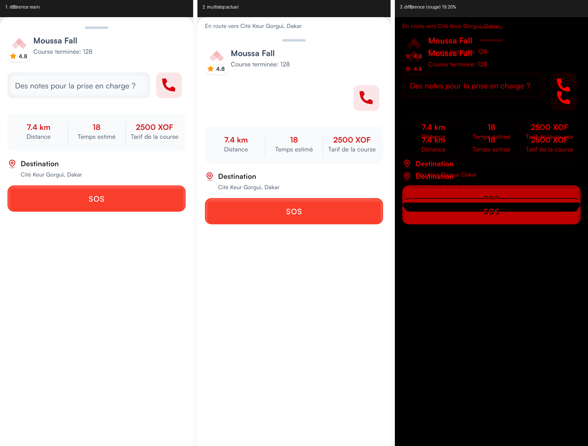
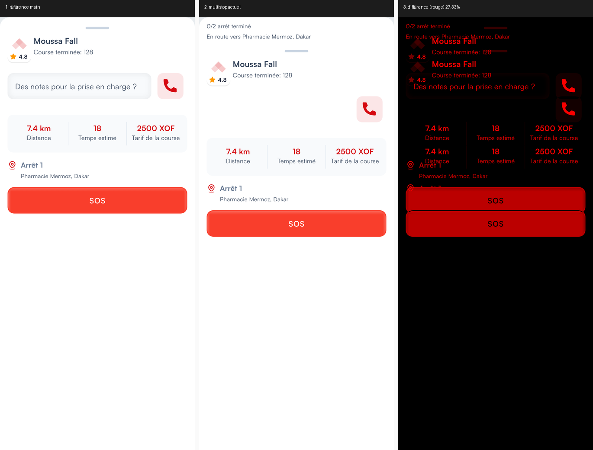
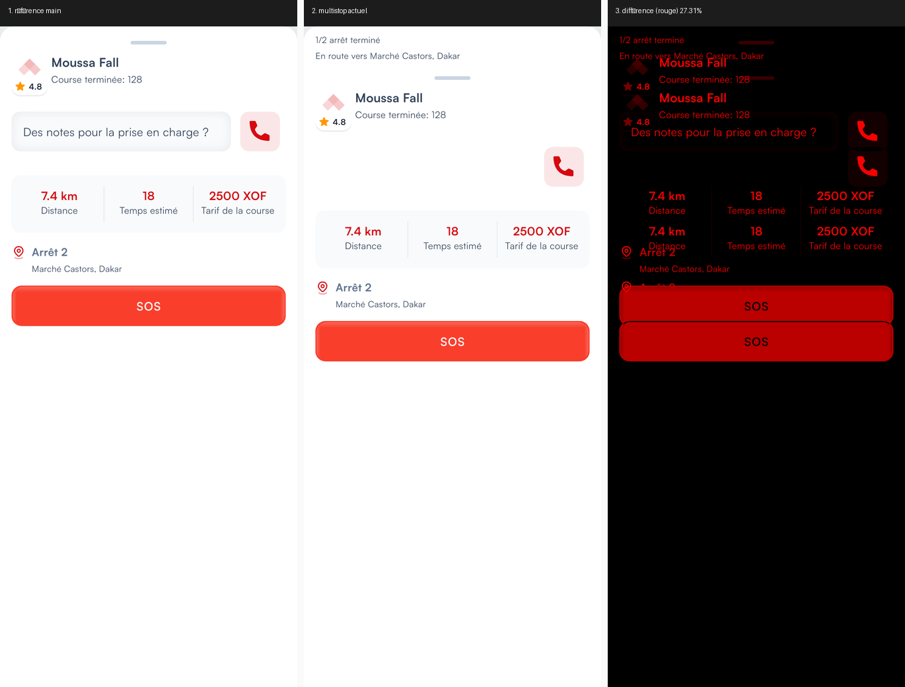
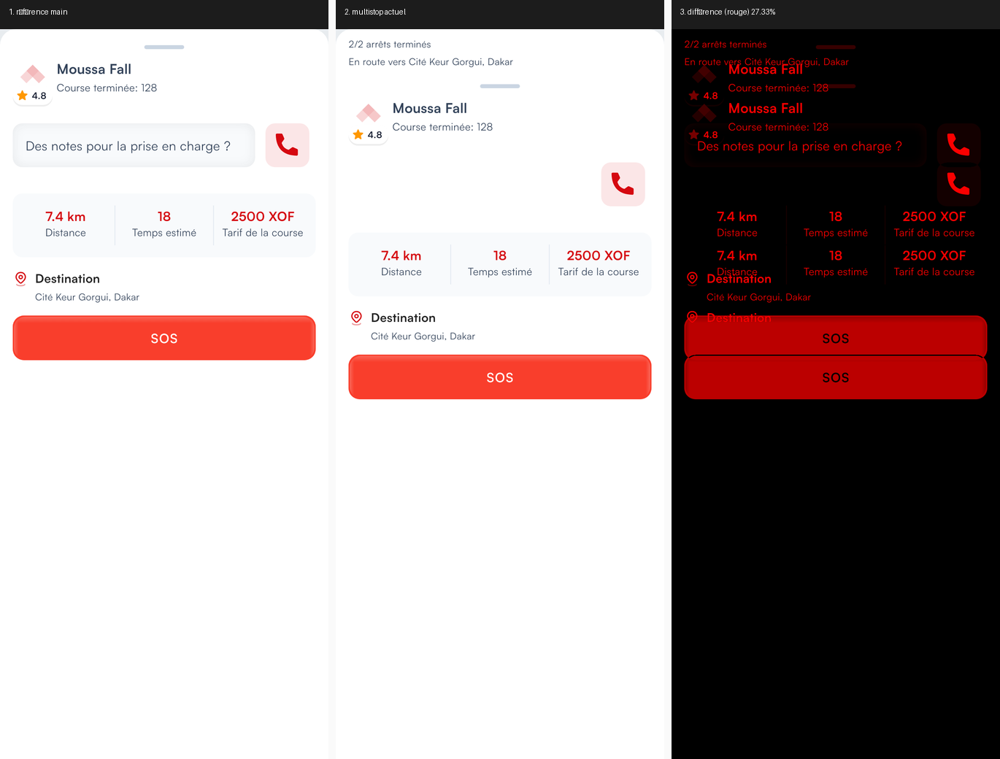
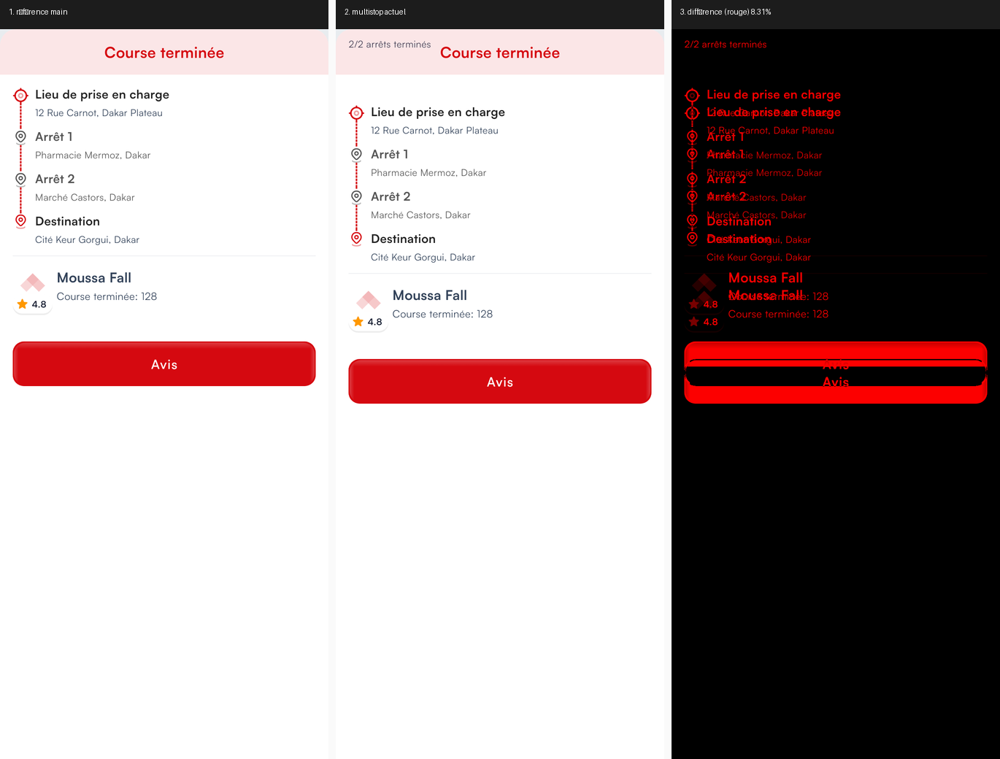

# Validation goldens course — planches pour Papa

Date: 2026-11-27 15:58 Africa/Dakar  
Branche: `feat/multistop-rider-close-2026-11-20` @ `bf9dcb6` vs référence PNG (import main `7984da7`)  
**Aucune régénération / acceptation** — à valider écran par écran.

Légende de chaque planche : **1. référence main** | **2. multistop actuel** | **3. différence (rouge)**

---

## 1. `course_en_cours_simple` — **19.20 %**

- **Ajouté :** bandeau « En route vers Cité Keur Gorgui, Dakar » en haut de feuille.
- **Déplacé :** tout le bloc (profil, stats, destination, SOS) descend d’autant.
- **Multistop :** bandeau jambe courante = voulu (F4). Le décalage vertical est la conséquence directe.

---

## 2. `course_en_cours_stop1_actif` — **27.33 %**

- **Ajouté :** « 0/2 arrêt terminé » + « En route vers Pharmacie Mermoz, Dakar ».
- **Disparu :** tuile « Des notes pour la prise en charge ? » (présente sur main) — **régression F4-25**, pas voulu ; mini F4-25 en cours pour la restaurer.
- **Déplacé :** profil / stats / Arrêt 1 / SOS plus bas ; bouton appel reste, sans la tuile notes à gauche.

---

## 3. `course_en_cours_stop1_fait` — **27.31 %**

- **Ajouté :** « 1/2 arrêt terminé » + « En route vers Marché Castors, Dakar » (jambe 2).
- **Disparu :** même tuile notes (régression F4-25).
- **Déplacé :** reste de la feuille vers le bas. Compteur d’arrêts = voulu multistop ; notes = à corriger.

---

## 4. `course_en_cours_tous_arrets_faits` — **27.33 %**

- **Ajouté :** « 2/2 arrêts terminés » + « En route vers Cité Keur Gorgui, Dakar ».
- **Disparu :** tuile notes (idem F4-25).
- **Déplacé :** profil / stats / destination / SOS. En-tête multistop voulu ; notes non.

---

## 5. `course_terminee` — **8.31 %**

- **Ajouté :** pastille « 2/2 arrêts terminés » au-dessus de l’itinéraire.
- **Conservé :** timeline complète (prise en charge → Arrêt 1 → Arrêt 2 → destination), profil, bouton « Avis ».
- **Multistop :** compteur d’arrêts en fin de course = voulu ; petit décalage vertical = collatéral du pastille.

---

## Décision attendue (Papa)

Pour chaque écran : **garder la référence main** / **accepter le rendu multistop comme nouvelle référence** / **corriger le code d’abord** (ex. restaurer notes avant toute acceptation).  
Agent : **ne régénère et n’accepte aucun golden** tant que tu n’as pas validé écran par écran.
