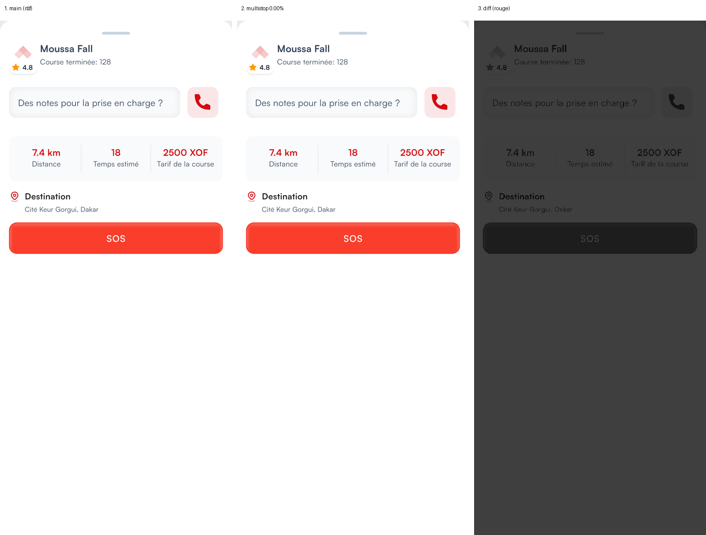
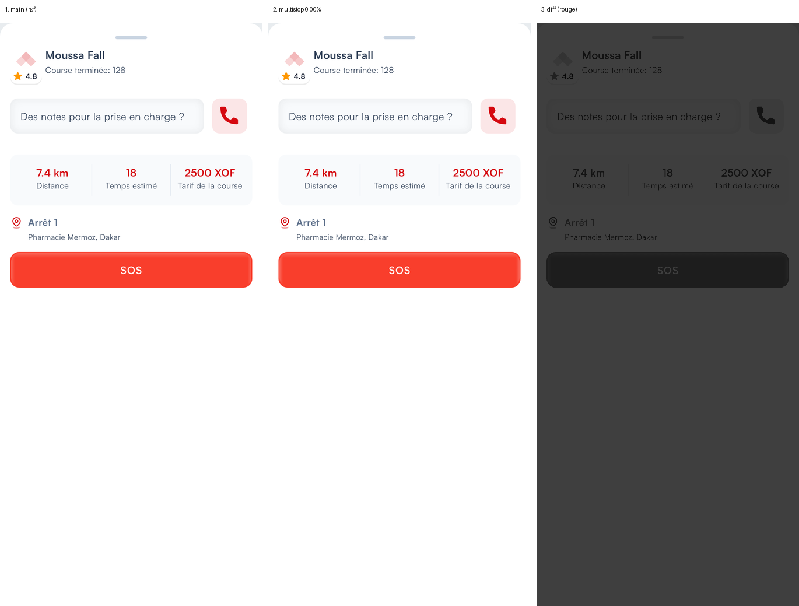
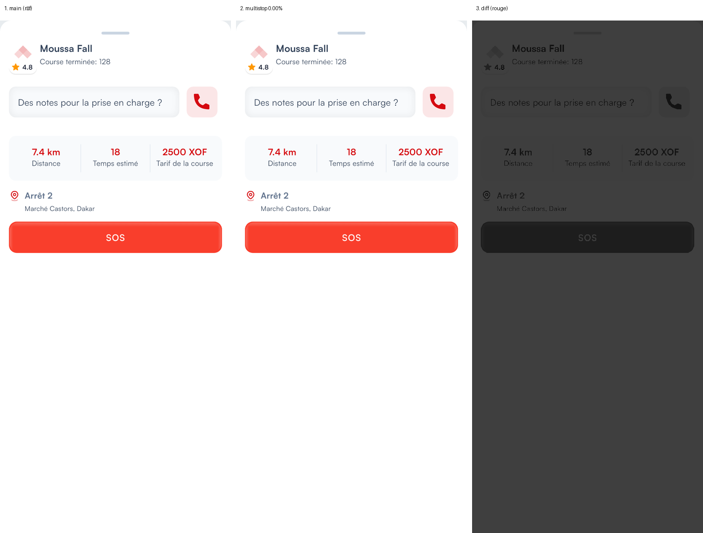
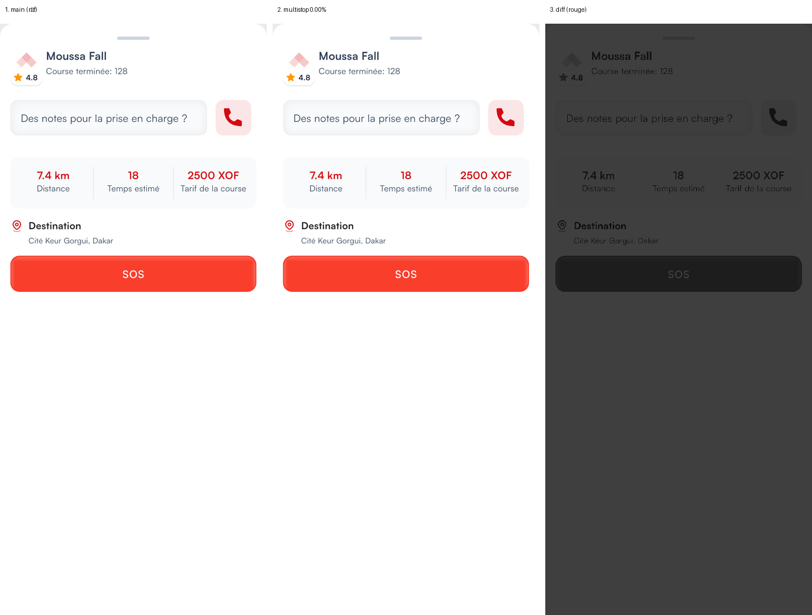
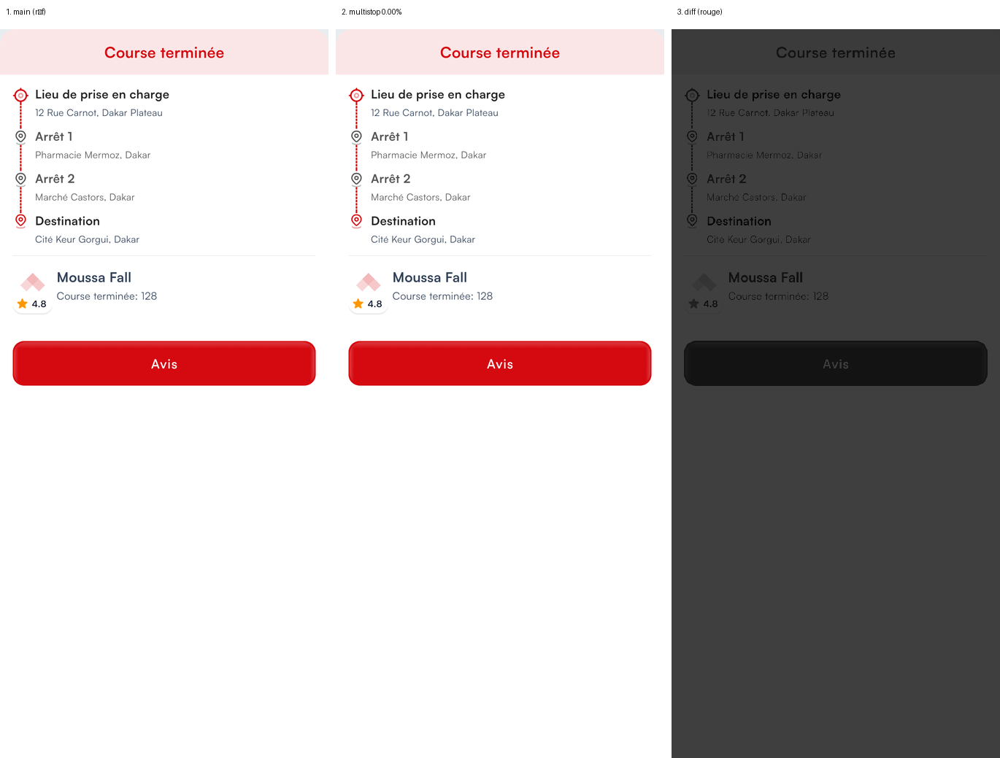

# Planches goldens après ui-match-main — tip `18ac9f5`

Date: 2026-11-27 16:20 Africa/Dakar

## Contexte
- Run ui-match-main : [46030222080](https://github.com/LordThiouk/lifeos-ci/actions/runs/46030222080) **PASS**
- Tip : `feat/multistop-rider-close-2026-11-20` @ **`18ac9f5`**
- Correctif : bandeau « En route… / x/N arrêts » retiré ; tuile notes F4-25 restaurée ; **aucun** `--update-goldens`

## Preuve CI (Flutter 3.44.8)
Rouge avant (tip `0409d4b`) : 5/6 goldens course en écart 8–27 %.  
Vert après : goldens course **6/6 à 0 %**, dossier rider **10/10**, ISC-F4-25 vert.

## Planches (chemins relatifs)
Légende : **1. référence main** | **2. multistop tip `18ac9f5`** | **3. diff rouge**

Fichiers PNG de référence tip = binaires **identiques** à `main` (sha256 match, 0 px) — confirmé localement ; la CI a validé le rendu widget contre ces références.

### course_en_cours_simple — **0,00 %**

Bandeau d’avancement retiré ; layout = main. Tuile notes absente ici (état sans RUNNING notes selon fixture).

### course_en_cours_stop1_actif — **0,00 %**

Plus de compteur « 0/2 » / « En route vers… ». Identique main.

### course_en_cours_stop1_fait — **0,00 %**

Idem — écart précédent (~27 %) résorbé.

### course_en_cours_tous_arrets_faits — **0,00 %**

Idem.

### course_terminee — **0,00 %**

Écran terminé sans bandeau ; = main.

## Suite
- F4-26 bouton message (mini build) — lancé après ce rapport
- F4-27 liste arrêts RUNNING — ensuite
- Goldens : **aucune régénération** ; références `main` restent la vérité
