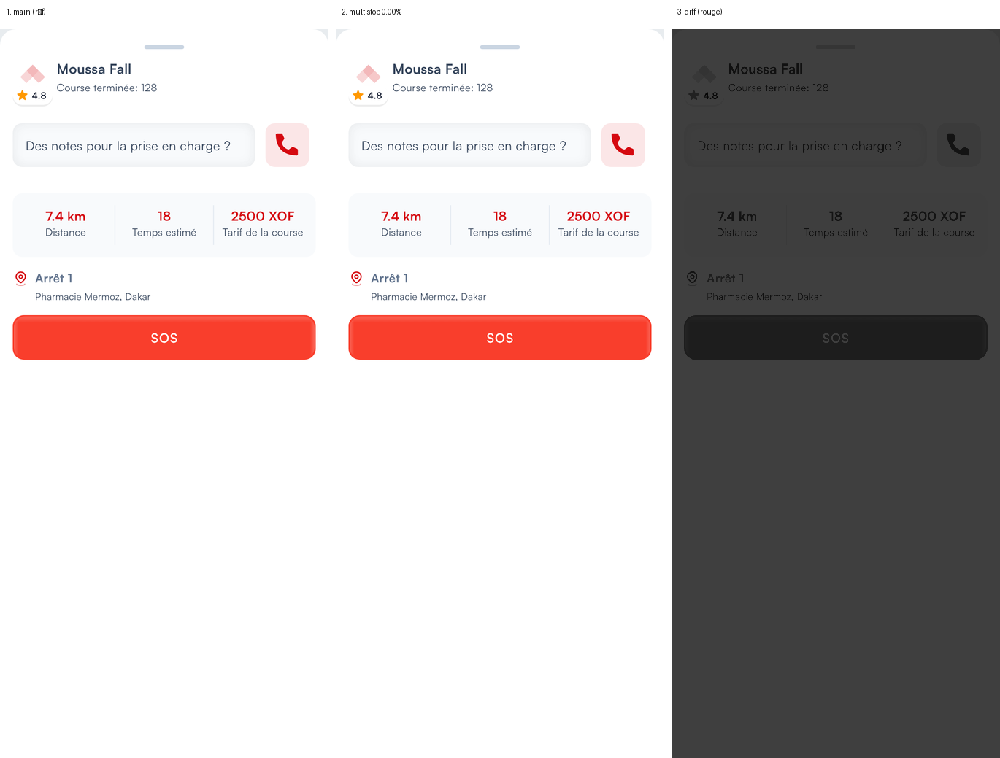
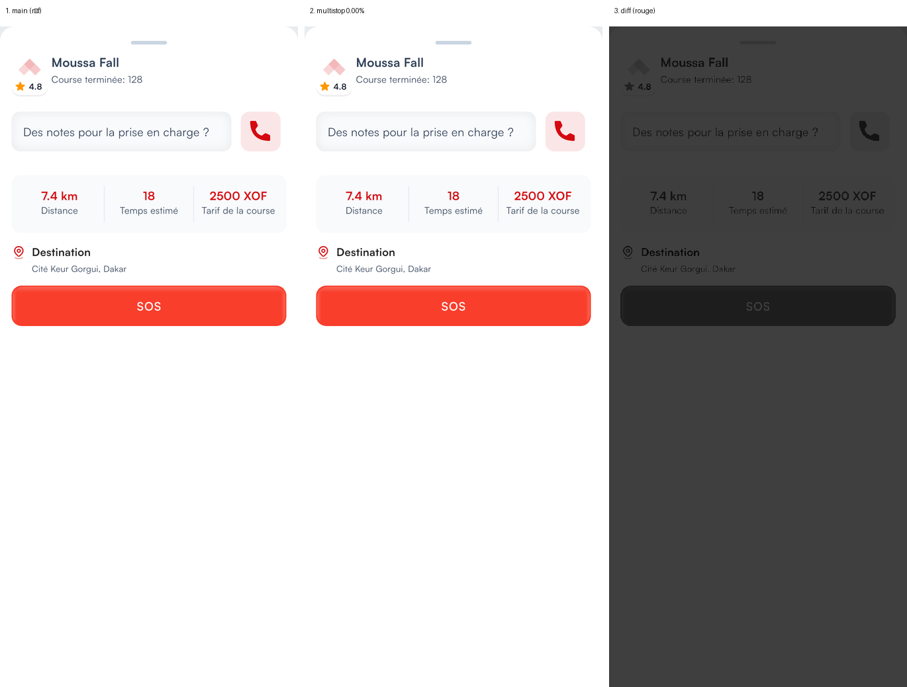
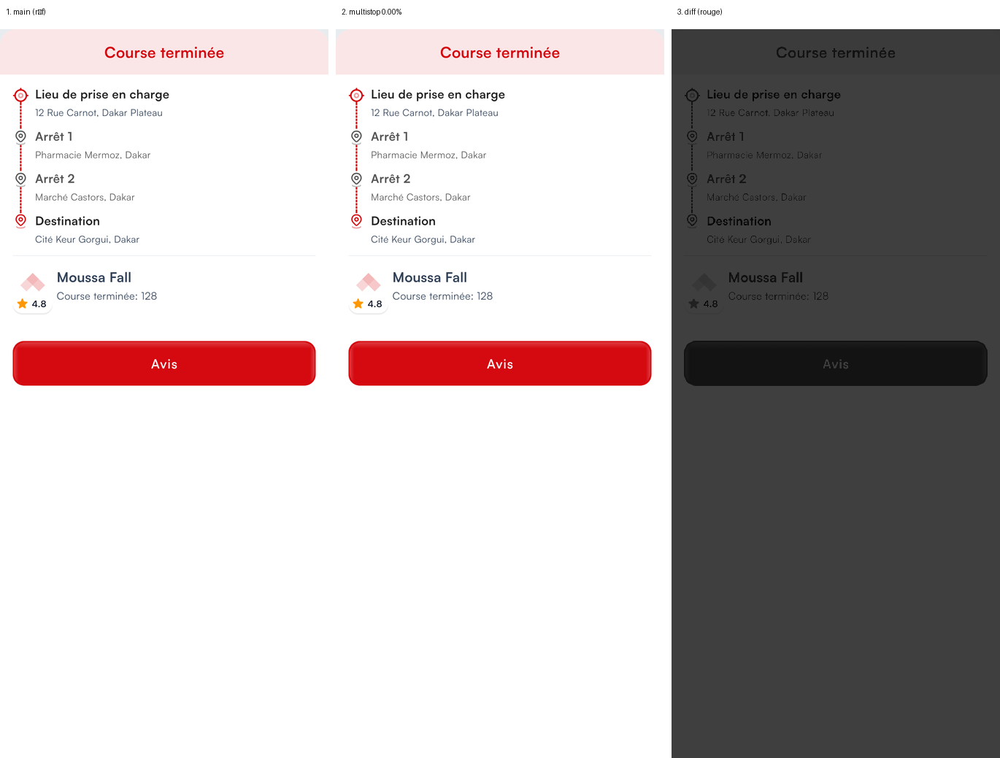
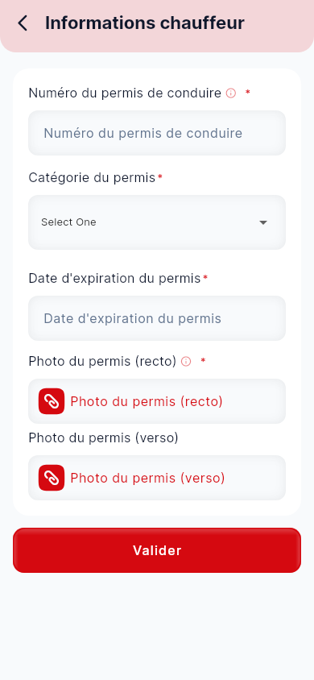
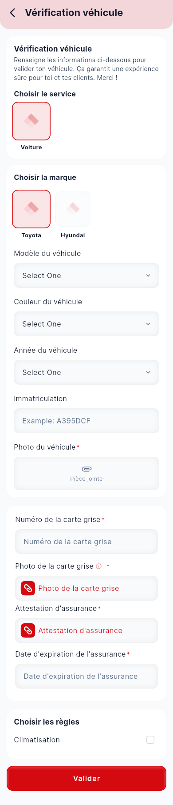
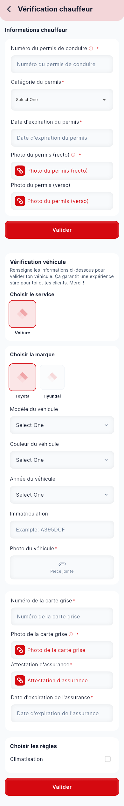

# Preuves visuelles — ISC déjà livrées

Chemins relatifs depuis `reports/galass-chantiers/`.

## F4-25 / 26 / 27 (Rider course — planches main | branche | diff)
| ISC | planche |
|---|---|
| F4-25 notes + contrat |  |
| F4-26 message |  |
| F4-27 liste arrêts |  |
| progression |  |
| terminée |  |

Sources brutes aussi sous `goldens-compare/*_{main,multistop,diff,board}.png`.

## ISC-10 KYC écran unique (Driver)
| Moment | capture |
|---|---|
| AVANT permis |  |
| AVANT véhicule |  |
| APRÈS unique |  |

Tip preuve : `eb7d54f` / `b1f08b7`.

## OTP / localisation / Artemis
- OTP Driver/Rider : captures widget à produire au prochain forge (keys `otp-edit-phone`) + SHA `07b0bbc` / Rider `efc37c2`.
- Localisation ISC-23 : preuve = tests `always_location_*` (pas encore PNG device) — à sortir d’Artemis.
- Artemis P0 : captures du run [46053833147](https://github.com/LordThiouk/galass-emu-actions-pub/actions/runs/46053833147) dès artefacts disponibles.
